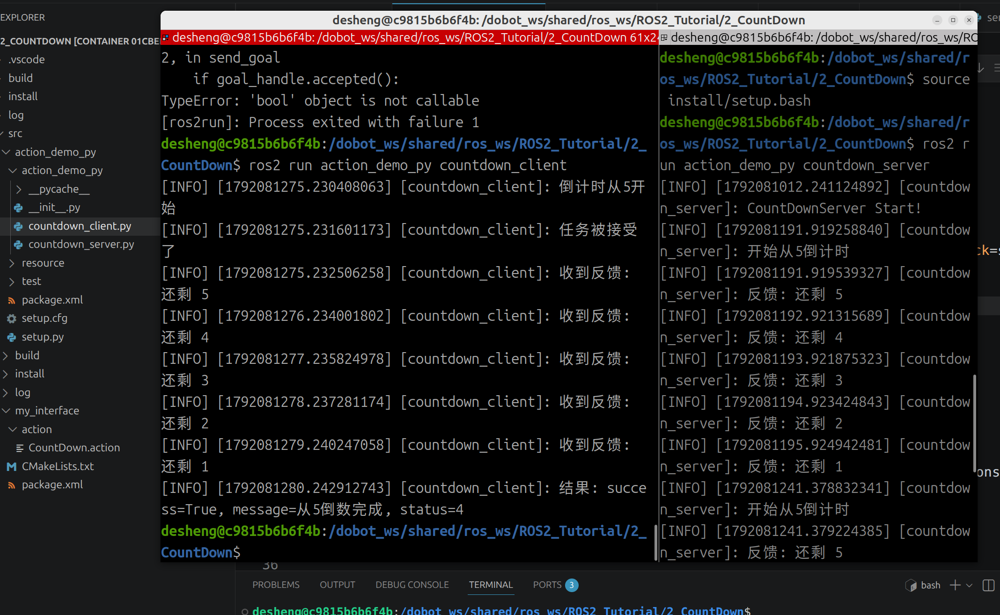
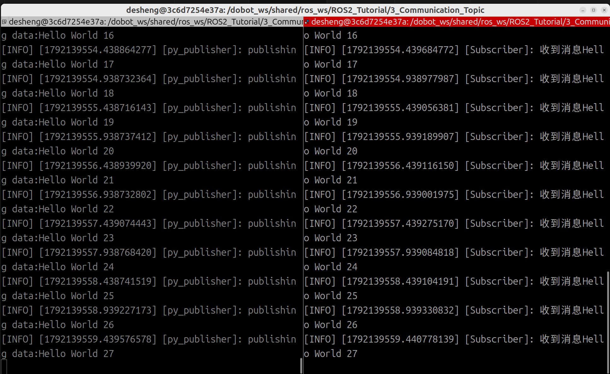
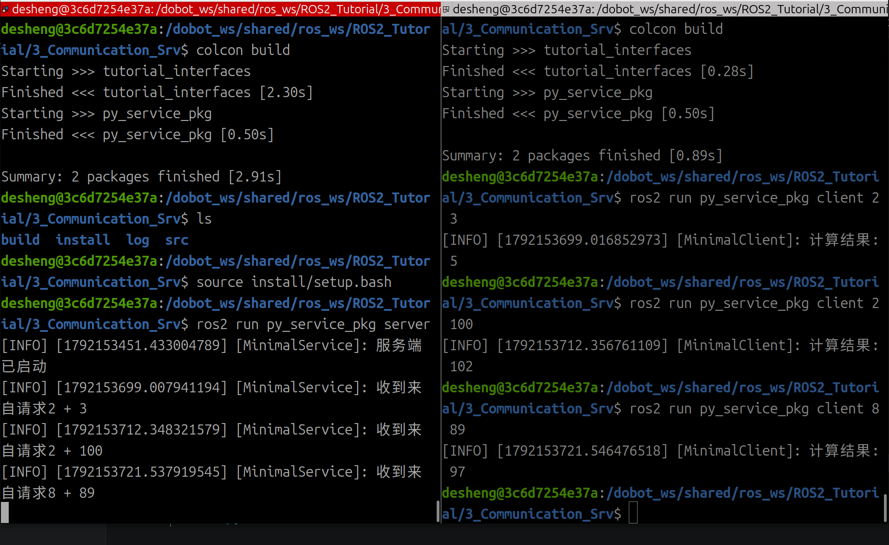
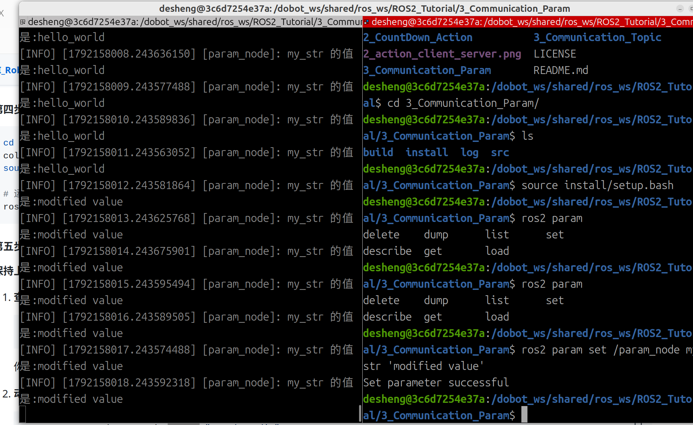

# ROS2_Tutorial


My ROS 2 learning notes and practice code, following Seeed Studio's ROS 2 beginner series
([AI_Robotics_Academy](https://github.com/Seeed-Projects/AI_Robotics_Academy)).

| 课 | 文件夹 | 内容 |
|---|---|---|
| 1 | [`HelloWorld`](HelloWorld) | 第一个 Python 节点 |
| 2 | [`2_CountDown_Action`](2_CountDown_Action) | 自定义 Action：倒计时 |
| 3 | [`3_Communication_Topic`](3_Communication_Topic) | 话题：发布者 + 订阅者 |
| 3 | [`3_Communication_Srv`](3_Communication_Srv) | 服务：自定义 AddTwoInts |
| 3 | [`3_Communication_Param`](3_Communication_Param) | 参数：声明、读取、运行时修改 |

---

## 环境与流程

Docker 容器（Ubuntu 22.04 + ROS 2 Humble）里编译运行，宿主机上 git。每一课是一个独立工作空间。

```bash
cd <课名>/src && ros2 pkg create <包名> --build-type ament_python --dependencies rclpy
cd .. && colcon build --symlink-install     # 在工作空间根目录编译，不要在 src 里
source install/setup.bash                   # 每个新终端都要 source
ros2 run <包名> <程序名>
```

- 只改了已有 `.py`：重启程序即可；改了 `setup.py` 或接口文件：重新编译 + source
- 自定义接口（`.msg` / `.srv` / `.action`）必须放在 `ament_cmake` 包里

## 三种通信方式

| | 话题 | 服务 | Action |
|---|---|---|---|
| 方式 | 单向、持续 | 一问一答 | 交任务 → 报进度 → 拿结果 |
| 接口文件 | `.msg`（1 段） | `.srv`（请求 `---` 响应） | `.action`（任务 `---` 结果 `---` 进度） |
| 例子 | `/joint_states` | `/compute_fk` | `FollowJointTrajectory` |

另外还有**参数（Parameter）**：存在每个节点内部的配置值，外部读写它底层走的是服务。

---

## 1 · HelloWorld

```python
rclpy.init()               # 初始化通信环境
node = Node('Hello_World_Node')
node.get_logger().info('...')
rclpy.spin(node)           # 一直运行，靠回调干活
rclpy.shutdown()
```

- `setup.py` 里登记程序：`'程序名 = Python包.文件名:main'`，`ros2 run` 用的是程序名
- 程序名、文件名、节点名是三回事

## 2 · CountDown（Action）



- 两个包：`my_interface`（`action/CountDown.action`）+ `action_demo_py`（服务端、客户端）
- 一个 Action = 3 个服务（send_goal / get_result / cancel_goal）+ 2 个话题（feedback / status），库自动创建
- 服务端：`publish_feedback()` 报进度，`succeed()` 设结局，`return result` 给结果
- 客户端：`send_goal_async()` → `get_result_async()`，进度在 `feedback_callback` 里收

```bash
ros2 run action_demo_py countdown_server
ros2 run action_demo_py countdown_client
```

## 3 · 通信机制：话题、服务、参数

### 话题（`3_Communication_Topic`）



```python
from std_msgs.msg import String

# 发布者：每 0.5 秒发一条
self.publisher_ = self.create_publisher(String, 'publish_py', 10)   # 类型、话题名、队列长度
self.timer = self.create_timer(0.5, self.timer_callback)

def timer_callback(self):                       # 定时器回调：不收参数
    msg = String()
    msg.data = f'Hello {self.count}'
    self.publisher_.publish(msg)

# 订阅者
self.create_subscription(String, 'publish_py', self.subscribe_callback, 10)

def subscribe_callback(self, msg: String):      # 收到一条消息调用一次
    self.get_logger().info(f'收到: {msg.data}')
```

- 两端的**话题名和类型必须一致**，靠名字自动连上
- `publish()` 发完立刻返回，**不等订阅者**
- 队列长度 10：每个订阅者有自己的队列，处理不过来就丢最旧的，互不影响
- `create_timer` 一创建就开始计时，但回调只在 spin 时才会被调用

```bash
ros2 topic list
ros2 topic echo /publish_py                                   # 看话题上的数据
ros2 topic info /publish_py                                   # 发布者、订阅者各几个
ros2 topic pub /publish_py std_msgs/msg/String "{data: hi}"   # 不写发布者也能测订阅者
```

### 服务（`3_Communication_Srv`）



接口 `tutorial_interfaces/srv/AddTwoInts`（`int64 a, b --- int64 sum`），代码包 `py_service_pkg`。

```python
# 服务端
self.create_service(AddTwoInts, 'add_two_ints', self.callback)
def callback(self, request, response):
    response.sum = request.a + request.b
    return response

# 客户端
self.cli = self.create_client(AddTwoInts, 'add_two_ints')
while not self.cli.wait_for_service(timeout_sec=1.0): ...   # 每次最多等 1 秒
future = self.cli.call_async(req)
rclpy.spin_until_future_complete(self, future)
```

```bash
ros2 run py_service_pkg server
ros2 run py_service_pkg client 2 3      # 计算结果: 5
```

### 参数（`3_Communication_Param`）



参数是节点的配置项（比如速度、串口号）。ROS 2 没有全局参数服务器，**每个节点自己保存自己的参数**。

```python
self.declare_parameter('my_str', 'hello_world')     # 先声明（名字, 默认值），才能使用
self.timer = self.create_timer(1.0, self.timer_callback)

def timer_callback(self):
    my_str = self.get_parameter('my_str').get_parameter_value().string_value
    self.get_logger().info(f'my_str 的值是:{my_str}')
```

- 定时器每次都重新读取参数，所以外部一修改，下一秒的输出就变了
- 外部读写参数，底层调用的是节点自带的服务（`ros2 service list` 能看到 `/param_node/set_parameters` 等）

```bash
ros2 run py_param_pkg param_node
ros2 param list                                       # 列出所有节点的参数
ros2 param get /param_node my_str                     # 读
ros2 param set /param_node my_str 'modified value'    # 改：Set parameter successful
ros2 run py_param_pkg param_node --ros-args -p my_str:=abc   # 启动时就指定参数值
```

---

## 要点速记

- `rclpy.spin(node)` 会停在那一行；所有回调都靠 spin 家族来调用
- 回调作为参数时只写函数名，不加括号：`callback=self.cb`
- `self.a.f(x)`：点号前的对象自动传入；`rclpy.xxx(node, ...)` 这种模块函数要显式传节点
- 检查接口：`ros2 interface show 包名/srv/类型名`；"找不到类型"通常是终端没 source
- VS Code 找不到自定义接口：`settings.json` 的 `python.analysis.extraPaths` 里加 `<课名>/install/<接口包>/local/lib/python3.10/dist-packages`

| 回调 | 收到 | 返回 |
|---|---|---|
| 定时器 | 无 | 无 |
| 话题订阅 | `msg` | 无 |
| 服务端 | `request, response` | `response` |
| Action `execute_callback` | `ServerGoalHandle` | `Result` |
| Action `feedback_callback` | `feedback_msg`（`.feedback`） | 无 |

---

## License

[GPL-3.0](LICENSE)
